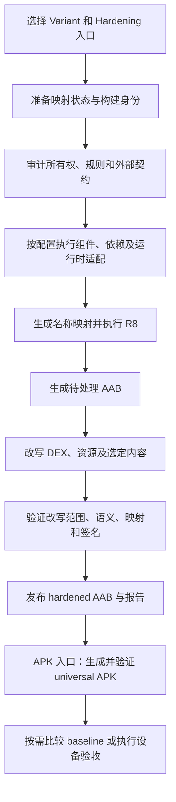

# Android Hardening Gradle Plugin 1.5.1 详细介绍

编写日期：2026-10-16。插件 ID：`com.holin.android.hardening`。

本文介绍本地 1.5.1 实现的功能、接入方式、名称混淆范围、构建产物和验证边界，适合 Android 开发、构建维护和测试人员阅读。

**版本状态：1.5.1 当前是本地验证版。** 本文与 1.5.0 运行时内容保护、1.5.1 Git 环境修复的分版本源码提交配套。源码提交不等于已经发布 GitHub Release 或远程 Maven 包；使用时须由完整 1.5.1 源码构建本地 Maven 包，或取得对应的已验证交付包，并核对版本及校验和。仓库中的旧版启动器和下载示例仍保持各自固定的版本。

## 1. 插件定位

插件为 Android Application 的指定 Variant 提供受控的代码与资源转换。它先确认代码、资源属于应用自有范围，再分析反射、序列化、JNI、资源查找等名称依赖，在构建过程中执行 R8 名称映射、DEX 转换和 AAB 资源改写，最后验证并签名输出。

它的主要用途包括：

- 为自有包、类、方法及符合条件的字段生成可复用的混淆名称。
- 修改资源逻辑名和产物中的资源文件名，同时维持资源 ID 与引用关系。
- 在明确范围内改变 DEX、图片、字体、JSON、Native 文件或 Bundle 元数据的表示。
- 对能确认全部相关读取方式的字符串、assets 和部分图片执行运行时内容保护。
- 记录转换范围、保留原因、映射连续性、语义校验、签名和相似度结果。

普通构建默认不进入 Hardening 流程。开发者需选择目标 Variant、配置所有权与兼容性输入，并调用 Hardening 入口。插件的转换报告可以解释具体发生了什么；编译通过、文件 hash 变化和相似度下降分别证明不同的事情。

## 2. 构建流程



图中包含按配置启用的分支；实际任务依赖由目标 Variant 和入口决定。`bundle<Variant>Hardening` 只交付 AAB；`assemble<Variant>Hardening` 才包含 APK 生成。设备安装、启动和观察通过 `hardeningRun<Variant>` 单独进入。

构建链内部用于后续改写的 AAB 可能已经经历 R8 和运行时适配。比较“加固关闭 / 加固开启”时，关闭组应由独立的普通构建生成，不能把中间 AAB 自动视为未加固基线。

## 3. 名称混淆能力总表

| 对象 | 当前能力 | 生效范围与限制 |
| --- | --- | --- |
| Java/Kotlin 包名 | 已实现 | 对可改名的自有类分配包路径；部分保留类会限制包名变更。 |
| Java 类名 | 已实现 | 通过名称分配器生成映射，再由 R8 应用到编译产物。 |
| Kotlin 类名 | 已实现 | 同样在编译后的 JVM 字节码层处理，受来源证明、metadata 和外部契约约束。 |
| 方法名 | 已实现 | 内部重写关系按组分配名称；外部方法契约、构造方法等保留。 |
| 字段名 | 有条件实现 | 可改名字段进入映射；潜在 Bean 字段、部分序列化及反射字段保留。 |
| `res/layout` 等资源文件名 | 已实现 | 改写 AAB 中的文件名和资源表文件引用；源码目录中的文件不改名。 |
| 资源逻辑名 | 已实现 | 修改资源表条目名称；保持资源 ID，排除外部名称依赖。 |
| `style` 名称 | 已实现 | 作用于资源表名称，不代表重排 style 内容或布局结构。 |
| `string`、`color`、`dimen` 名称 | 有条件实现 | 需要值资源策略启用并通过筛选；动态查找或外部观察会限制转换。 |
| `id`、`attr`、`styleable` 等其他名称 | 不属于当前独立资源改名类型集合 | 不能把已有资源改名能力理解为覆盖所有 Android 资源类型。 |
| 磁盘上的 `.java` / `.kt` 源文件名 | 不直接改名 | 插件没有源码文件批量重命名流程。 |
| DEX 中的 `SourceFile` 原始文件名 | 存在实现缺口 | DSL 声明了 `PSEUDONYMIZE`，但本次源码检查未发现专用改写链路，详见第 4.4 节。 |
| 普通 `assets` 文件名 | 默认保留 | `assetProtection` 的格式转换保持读取路径。 |
| 运行时保护的 `assets` 文件名 | 有条件实现 | 对选定且读取方式已证明可适配的 assets，加密并改为 `_h_<哈希>.bin`。 |
| `.so` 文件名、SONAME、Native 符号 | 保留 | 当前 Native 转换改变文件表示，不改机器码、加载内容或符号名称。 |
| 路由、URI、URL、硬编码文件名 | 审计与契约保护 | 扫描这些名称不等于自动改写所有值；未解析的自有引用可能导致构建失败。 |

### 3.1 当前资源类型

资源名称模型包含 `layout`、`drawable`、`style`、`mipmap`、`font`、`raw`、`anim`、`animator`、`xml`、`string`、`color` 和 `dimen`。类型受支持只是第一步，还要满足所有权、配置范围、资源表关联和外部契约条件。

### 3.2 名称改写不等于内容改写

资源可分别拥有逻辑名称、数字 ID 和实际文件路径。例如，`R.drawable.logo` 对应一个资源 ID，并在不同密度下引用不同文件。名称混淆会维护这些关联，而图片像素转换、加密和 XML 结构转换又是不同能力。

`values/strings.xml` 这类源码文件通常编译进资源表。对其中 string 名称的处理，不能描述为把产物中的 `strings.xml` 文件直接改名。

## 4. 代码与资源名称如何生成

### 4.1 稳定伪词名称与 R8

`PseudowordRegistry` 使用 seed、符号身份和冲突探测生成名称。类名使用首字母大写的词组合，成员名使用驼峰组合，包段使用小写组合，资源别名使用下划线组合。

`CodeNameAllocator` 分配包、类和成员名称，生成代码映射；`GenerateHardeningCodeMappingTask` 输出 `-applymapping` 规则，`AgpHardeningConfigurer` 将规则接到目标 Variant 的 R8 输入。它是实际构建流程的一部分。

已有有效映射和 registry 会复用。因此，同一映射 lineage 中的稳定符号通常沿用上次名称。默认每次构建变化的是内容 salt，不应把它理解为每次都重新随机生成全部类名和资源名。

### 4.2 需要保留的名称

保留范围包括但不限于：

- JVM 构造方法和类初始化方法，以及触及平台或第三方声明的外部重写方法。
- JNI native 方法、`@JavascriptInterface` 方法和 Java Serializable 契约。
- 潜在 Bean 实例字段、未显式声明序列化名称的 Gson 字段和 ObjectBox Entity 相关名称。
- Manifest 声明类、自定义 View、路由、EventBus、ViewModel 工厂等场景中的具体契约。
- 精确保留规则、已解析的硬编码成员名及无法建立自有源码证明的对象。

具体由所有权扫描、`OwnedCodeContractClassifier`、规则分析和可选的组件策略共同决定。构建发现无法解析的自有反射、资源查找或硬编码引用时，会按策略拒绝继续，或在对应功能中排除并报告；不会仅凭名称外观推断安全性。

### 4.3 资源逻辑名与文件名

资源物理名称使用 `sl_<资源类型>_<伪词>` 格式。以下是格式示意，不是某次构建的真实映射：

```text
res/layout/activity_home.xml
    → res/layout/sl_layout_word_word_word.xml

资源表逻辑名 activity_home
    → sl_layout_word_word_word

资源 ID
    → 保持原值
```

同一资源的不同限定符配置共用相应映射，文件后缀和限定符目录保持一致。资源表引用同步更新，避免仅改 ZIP 文件名导致加载失败。

当前主构建链对 `drawable/icon_notification` 有特殊处理：保持其逻辑名，允许受约束的物理路径替换。图片内容转换的通知图标、动画、NinePatch 等排除规则应单独查看，不能据此推断所有文件名都原样保留。

### 4.4 Java/Kotlin 文件名与 `SourceFile` 缺口

需要区分三件事：

1. 工程中的 `UserManager.kt` / `UserManager.java`：插件不直接重命名源码文件。
2. 编译后的类名称：符合条件时由 R8 重命名，反编译工具可能据此显示新的文件名。
3. 产物中的原始源码文件名元数据：可能通过 `SourceFile` 等信息继续暴露来源。

本地代码确实定义了 `SourceFileMode.PSEUDONYMIZE`，扩展校验也要求这一值。然而，本次检查没有找到插件生成的 `-renamesourcefileattribute` 规则或专门的 SourceFile 伪装转换；后续 `SafeDexTransformer` 沿用输入的 `classDef.sourceFile`，语义验证也要求前后相同。

因此，**当前只能确认配置意图，不能宣称插件已经独立实现完整的 Java/Kotlin 原文件名隐藏。** R8 版本、消费项目规则和最终产物仍可能影响结果，应检查实际 DEX 与反编译结果。这个结论同样不能扩大为“所有 Kotlin metadata 和调试信息都已清理”。

## 5. 名称以外的保护能力

| 能力 | 实际作用 | 适用条件或边界 |
| --- | --- | --- |
| DEX 转换 | 对符合条件的自有方法执行受控指令转换，记录有效覆盖率、距离和增长 | 不等于虚拟机壳、动态代码加载或全量 DEX 加密。 |
| 图片感知模式 | 在约束内改变图片编码或像素特征，检查 SSIM、pHash 等指标 | 仅适用于显式选择并通过格式、alpha、尺寸等验证的候选。 |
| 图片像素完全保持模式 | 改变表示并验证尺寸、RGBA、渲染信息及背景合成结果 | 允许视觉与像素 pHash 保持不变，不能据此宣称视觉内容不可识别。 |
| 普通 assets 格式转换 | 对支持的图片、SFNT 字体和 JSON 执行格式等价转换 | 默认保留路径；JSON token、字体语义等按具体格式验证。 |
| 运行时字符串保护 | 对选定资源字符串加密并适配可追踪的读取调用 | 不覆盖任意字符串常量、富文本、数组、plurals 或所有自定义读取器。 |
| 运行时 assets 保护 | 加密原始字节、替换路径并适配读取操作 | 需要明确 assets 路径和自有 reader；Native、WebView 等任意访问不自动适配。 |
| 运行时图片保护 | 为选定 PNG/WebP drawable 建立加密 XML 容器及运行时 Drawable | 当前契约面向 API 26+ 的普通 XML drawable 加载；不覆盖所有 Bitmap/自定义 View 读取。 |
| 内部组件改名 | 对身份引用可确认的私有 Java Activity 做受控改名 | 可通过旧组件 alias 维持调用；导出组件、intent-filter、未解析 Kotlin metadata 等受限。 |
| 依赖保护 | 记录来源，并对允许列表中的合格纯 Java 工具类做受控重定位 | 空允许列表仅生成来源信息；不会任意重写所有第三方 SDK。 |
| Native 格式转换 | 在验证加载语义不变的情况下增加非加载尾部数据 | 原始 ELF 字节、机器码、符号、重定位、SONAME 和 build-id 保留。 |
| Bundle 元数据处理 | 按配置移除精确依赖元数据条目，或增加受限结构条目 | 不改变依赖坐标和运行时依赖，相关 Bundle 条目不得进入 universal APK。 |

运行时字符串、assets 和图片使用带认证的 AES-GCM envelope，并通过独立恢复检查核对原始内容。同一 payload 的编码转换与加密分别统计；被选中加密的原始 asset/图片不会先额外执行一次格式转换。

应用运行时需要解码能力。上述保护增加静态直接提取的难度，但不能保证运行中的明文或像素永远无法获取。

## 6. 环境与接入前提

| 项目 | 当前要求 |
| --- | --- |
| Gradle | 8.10 或更高，并使用消费项目自己的 Wrapper |
| Android Gradle Plugin | 8.8 或更高，且通过插件的 public API capability probe |
| JDK | 17 或更高 |
| Kotlin Android Plugin | 2.3 或更高 |
| Android 工具链 | 对应 SDK、Build Tools、Platform Tools |
| 应用模块 | Android Application，目标 Variant 和生产 source set 真实存在 |
| 签名 | 目标 Variant 已配置可用签名材料 |
| 既有插件兼容性 | 真实的旧插件声明、配置输入及已捕获的 baseline |

最低版本号不保证任意组合都能运行，插件还会检查需要的 AGP 能力。便携包不包含消费项目的全部 AGP、Kotlin 或业务依赖；离线使用前仍需准备这些依赖。

当前 v1 实现要求 `existingPlugins` / legacy baseline。即使某个新项目没有既有加固插件，也不能通过虚构一个插件或空 baseline 绕过检查。首次集成需先处理这一前置要求。

### 6.1 获取本地 1.5.1 包

由维护者在包含完整 1.5.1 实现的源码工作区执行：

```shell
./gradlew packagePortableHardeningPlugin verifyPortableHardeningPlugin
```

预期交付文件为：

```text
build/distributions/hardening-gradle-plugin-1.5.1-portable-maven.zip
build/distributions/hardening-gradle-plugin-1.5.1-portable-maven.zip.sha256
```

消费方核对外层 SHA-256，解压后核对包内 `SHA256SUMS`，再使用其中的 `repository`。已有 `hardeningw` 启动器可能固定到旧版本；1.5.1 本地接入应使用消费项目的 `./gradlew` 和匹配的本地包。

### 6.2 配置插件仓库

在消费项目 `settings.gradle.kts` 的 `pluginManagement` 中加入独占本地仓库解析。下面是可合并到现有配置的示例：

```kotlin
pluginManagement {
    val hardeningRepository = providers.gradleProperty("hardeningPluginRepo").orNull
        ?: error("Pass -PhardeningPluginRepo=<extracted>/repository")
    repositories {
        exclusiveContent {
            forRepository {
                maven {
                    name = "ExtractedHardeningPlugin"
                    url = uri(hardeningRepository)
                }
            }
            filter {
                includeGroup("com.holin.android.hardening")
            }
        }
        google()
        mavenCentral()
        gradlePluginPortal()
    }
}
```

根 `build.gradle.kts` 在现有插件配置中增加：

```kotlin
plugins {
    id("com.holin.android.hardening") version "1.5.1" apply false
}
```

Application 模块在既有 Android/Kotlin 插件之后应用：

```kotlin
plugins {
    id("com.android.application")
    id("org.jetbrains.kotlin.android")
    id("com.holin.android.hardening")
}
```

### 6.3 基础 DSL 示例

示例使用模块 `:app`、Variant `release`。项目名、路径、规则、旧插件输入和 source set 都应替换为真实值。已有旧插件必须实际应用；`legacyPluginId` 和 `legacyPluginVersion` 为消费方提供的真实 Gradle 属性。

```kotlin
androidHardening {
    projectKey.set("demo")
    targetVariants("release")

    ownership {
        module(":app") {
            sourceSets.add("main")
        }
        generatedPackagePrefixes.add("com.example.app.generated")
        excludedPackagePrefixes.add("com.example.app.external")
    }

    proguardRules("proguard-rules.pro")

    mapping {
        storeDirectory.set(rootProject.layout.projectDirectory.dir(".hardening/mappings"))
        lockTimeoutSeconds.set(60)
    }

    existingPlugins {
        baselineFile.set(rootProject.layout.projectDirectory.file("hardening/legacy-plugin-baseline.json"))
        plugin("existing") {
            pluginId.set(providers.gradleProperty("legacyPluginId"))
            expectedVersion.set(providers.gradleProperty("legacyPluginVersion"))
            configurationInputs.from(layout.projectDirectory.file("build.gradle.kts"))
        }
    }
}
```

真实旧插件使用的其他配置文件和 mapping 输出应按实际情况添加到 `configurationInputs`、`mappingPaths`，并与 baseline 一致。上面的路径占位不构成已经可用的 baseline。

多模块应用需要逐个声明 `ownership.module`，不能认为应用模块依赖到的所有项目和 SDK 都自动归插件所有。source set 按配置顺序参与优先级选择。

名称策略、R8 引擎、资源 ID 保持等 v1 固定策略由插件管理。旧 `naming`、`code.sourceFileMode` 等属性仍用于兼容校验，不应仅因 DSL 中存在某个值就判断其功能已经完整实现。

## 7. 可选功能配置

以下片段均写在 Application 模块的 `androidHardening` 块内，可按需要合并。默认关闭的能力应先声明小范围，再依据报告和实际页面表现扩大范围。

### 7.1 值资源名称

```kotlin
resources {
    values {
        enabled.set(true)
        includes.set(setOf("string/*", "color/*", "dimen/*"))
        minimumCoverage.set(0.0)
    }
}
```

该功能侧重名称，资源数值或文案内容的加密属于另一策略。动态查找、外部名称观察和不可证明引用会影响适用范围。覆盖率为 `0.0` 允许报告跳过；正值会将覆盖率作为构建要求。

### 7.2 图片范围与像素完全保持模式

```kotlin
ownership {
    module(":app") {
        images {
            formats(PNG, WEBP, JPEG)
            include("src/main/res/drawable*/*.png")
            include("src/main/res/drawable*/*.webp")
            include("src/main/res/drawable*/*.jpg")
            exclude("src/main/res/drawable*/*.9.png")
        }
    }
}
resources {
    bitmapDiversification {
        mode.set(PIXEL_EXACT)
        minimumSsim.set(1.0)
        minimumPHashDistance.set(0)
        minimumCoverage.set(0.90)
    }
}
```

图片 glob 相对于声明的模块目录；只保留实际存在且需要处理的范围。`PIXEL_EXACT` 要求 SSIM 为 `1.0`、最小 pHash 距离为 `0`。默认 `LEGACY_PERCEPTUAL` 使用不同约束，不能混用两种模式的验收标准。

### 7.3 普通 assets 格式转换

```kotlin
assetProtection {
    enabled.set(true)
    includes.set(setOf("owned/images/*.png"))
    images.set(true)
    minimumCoverage.set(1.0)
}
```

路径相对于 assets 根目录。字体和 JSON 分别使用 `fonts`、`json` 开关。此配置保持 asset 文件路径；需要加密和路径替换时使用下节运行时保护。

### 7.4 运行时字符串、assets 和图片

```kotlin
runtimeProtection {
    strings.add("internal_status")
    minimumStringCoverage.set(1.0)

    assetPaths.add("owned/settings.json")
    assetReaders.add("com/example/app/Reader#load(Landroid/content/res/AssetManager;)V")
    minimumAssetCoverage.set(1.0)

    images {
        enabled.set(true)
        includes.set(setOf("drawable/owned_hero"))
        minimumCoverage.set(1.0)
    }
}
```

`assetReaders` 使用真实的 JVM 内部类名、方法名和 descriptor，不能直接填写 Kotlin 源码函数签名。图片 `includes` 使用 `drawable/name` 资源身份，与前面的源码文件 glob 含义不同。

1.5.0/1.5.1 增强了内联资源 ID、继承读取器、已打包依赖中的转发调用及选定 assets 的 open/list/descriptor 分析。未知读取器、Native/WebView 访问、系统资源、Manifest/theme/value 引用、NinePatch、动画和不支持的图片消费者仍需排除。是否实际转换以报告为准。

### 7.5 内部组件、依赖与 Native

```kotlin
componentProtection {
    enabled.set(true)
    includes.add("com.example.app.InternalActivity")
}
dependencyProtection {
    enabled.set(true)
    includes.add("com.example:pure-utility:1.0")
}
nativeProtection {
    enabled.set(true)
    includes.add("base/lib/*/*.so")
}
```

组件使用完整类名，依赖使用明确的 artifact 坐标，Native 使用 AAB entry 路径。示例依赖坐标需要替换为真实输入。第三方库即使位于允许列表中，也必须通过无状态、无 Native/反射/序列化等适用性分析。

### 7.6 DEX 阈值和 Bundle 元数据

```kotlin
code {
    diversification {
        minimumCoverage.set(0.50)
        minimumSimHashDistance.set(4)
        maximumGrowth.set(0.05)
        enforceMaximumGrowth.set(false)
    }
}
bundleMetadata {
    dependencyMetadata.set(OMIT)
    structuralMetadataEntryCount.set(16)
}
```

`maximumGrowth` 是比例，`0.05` 表示 5%；是否强制由对应开关决定。`OMIT` 仅移除 `BUNDLE-METADATA/com.android.tools.build.libraries/dependencies.pb`。结构条目数量范围是 `0..64`，默认 `0`，每个条目为 32 字节，位于插件专用 Bundle 元数据目录。

## 8. 常用构建命令

以下命令假设 1.5.1 仓库已解压到消费项目的 `.local/hardening-1.5.1/repository`，且所有接入前提已满足。不同命令应分别调用。

```shell
# 普通 AAB，作为独立的关闭组
./gradlew -PhardeningPluginRepo=.local/hardening-1.5.1/repository \
  -PandroidHardening=false :app:bundleRelease

# Hardened AAB：入口自动在隔离构建中开启 Hardening
./gradlew -PhardeningPluginRepo=.local/hardening-1.5.1/repository \
  :app:bundleReleaseHardening

# Hardened universal APK
./gradlew -PhardeningPluginRepo=.local/hardening-1.5.1/repository \
  :app:assembleReleaseHardening

# 兼容旧的显式开关入口
./gradlew -PhardeningPluginRepo=.local/hardening-1.5.1/repository \
  -PandroidHardening=true :app:hardeningBundleRelease
```

| 任务模式 | 作用 |
| --- | --- |
| `bundle<Variant>Hardening` | 自动启用 Hardening 的 AAB 入口，Gradle 分组为 `other`。 |
| `assemble<Variant>Hardening` | 自动启用 Hardening 的 universal APK 入口。 |
| `prepareHardening<Variant>` | 准备映射、registry、seed 和构建身份。 |
| `auditHardening<Variant>` | 审计所有权、契约、规则和既有插件。 |
| `verifyHardening<Variant>` | 验证映射、Bean 字段、Retrace 等结果。 |
| `archiveHardening<Variant>` | 将已验证状态及产物归档。 |
| `captureHardeningBaseline<Variant>` | 显式捕获用于后续比较的 baseline。 |
| `compareHardening<Variant>` | 按配置身份比较 baseline，并执行相对改善要求。 |
| `compareExternalHardening<Variant>` | 使用外部参考 AAB 进行比较。 |
| `hardeningRun<Variant>` | 在相关检查通过后安装、启动并观察设备，再归档。 |

除前两个便捷入口外，相关直接调用通常需要 `-PandroidHardening=true`。仅给普通 `bundleRelease` 添加该属性，并不能替代选择 Hardening 入口。

首次比较前，在审阅过的配置和输入上执行：

```shell
./gradlew -PhardeningPluginRepo=.local/hardening-1.5.1/repository \
  -PandroidHardening=true :app:captureHardeningBaselineRelease

./gradlew -PhardeningPluginRepo=.local/hardening-1.5.1/repository \
  -PandroidHardening=true :app:compareHardeningRelease
```

设备验证入口会安装并启动应用，只在需要执行设备验证时运行：

```shell
./gradlew -PhardeningPluginRepo=.local/hardening-1.5.1/repository \
  -PandroidHardening=true :app:hardeningRunRelease
```

默认只自动选择唯一在线设备，零台或多台时失败；可通过 `deviceTest.serial` 指定设备。默认从 Variant / Manifest 取得 application ID 和启动 Activity，并观察 30 秒。

## 9. 产物、报告与映射状态

以下路径相对于消费 Application 模块，`.hardening` 的实际位置则由配置决定。`<variant>` 使用实际 Variant 名，例如 `release` 或 `demoQa`。

| 路径 | 用途 |
| --- | --- |
| `build/outputs/hardening/<variant>/<variant>-hardened.aab` | 验证后的 hardened AAB。 |
| `build/outputs/hardening/<variant>/<variant>-hardened-universal.apk` | 由 hardened AAB 生成并验证的 universal APK。 |
| `build/reports/hardening/<variant>/audit.json` | 所有权、契约与兼容性审计。 |
| `build/reports/hardening/<variant>/code-naming.json` | 代码名称计划、预期符号和排除项。 |
| `build/reports/hardening/<variant>/potential-bean-fields.json` | 潜在 Bean 字段及其保护证据。 |
| `build/reports/hardening/<variant>/mapping-verification.json` | 最终映射与连续性验证。 |
| `build/reports/hardening/<variant>/bundle-verification.json` | AAB 改写和验证结果。 |
| `build/reports/hardening/<variant>/universal-apk-verification.json` | APK 构建、签名及相关验证。 |
| `build/reports/hardening/<variant>/runtime-readers.json` | 运行时读取器分析。 |
| `build/reports/hardening/<variant>/controlled-transformations.json` | 按能力列出的选定、转换、保留、覆盖率等结果。 |
| `build/reports/hardening/<variant>/category-report.json` | 分类后的产物分析。 |
| `build/reports/hardening/<variant>/similarity-report.json` / `.md` | 与 baseline 的比较结果。 |
| `build/hardening/<variant>/invocations/<invocation-id>/transformation-report.json` | 本次调用的具体转换记录。 |
| `build/hardening/<variant>/invocations/<invocation-id>/rewrite-manifest.json` | ZIP entry 替换、增加、移除的范围。 |
| `build/intermediates/hardening/<variant>/code-naming/code-mapping.txt` | 输入 R8 的代码名称映射计划，不应直接当成最终恢复映射。 |
| `.hardening/mappings/<projectKey>/<variant>/` | current、history、quarantine、locks 等映射状态。 |
| `.hardening/baselines/<projectKey>/<variant>/v1/` | 与项目、Variant 和配置身份绑定的比较基线。 |

报告是否生成取决于所走任务和启用能力。故障时应优先保留 invocation 目录及报告，核对第一处失败阶段。

映射计划、R8 编译器 mapping 和供外部 Retrace 使用的 canonical mapping 具有不同用途。崩溃还原应使用与交付产物一致的最终映射，不能使用其他构建的中间文件。映射与 seed/state 应按构建资产管理，不随意覆盖已有 current/history，也不作为公开应用内容分发。

## 10. 稳定性、相似度与验证口径

### 10.1 首次构建和连续构建

首次缺失旧 mapping 时建立新的 lineage，没有历史记录可供验证跨版本连续性。后续构建复用有效映射，检查符号关系、配置身份和 Retrace。损坏或身份不符的状态会被隔离处理。

`-PandroidHardeningFixedSeed=<non-secret-lab-seed>` 用于可复现性实验；它不能消除工具链、源码、依赖、签名或路径语义变化，也不应当作生产秘密。相同 seed 不意味着任意环境中输出都逐字节一致。

### 10.2 相似度分数

当前插件的自有结构相似度范围为 0–100，越低表示按该口径越不相似。v1 默认要求相对 baseline 的受测维度达到至少 `minimumImprovementPoints` 的改善，默认值为 `0.01` 个百分点。

绝对总分上限与 AAB 增长的相关值可用于报告，但 v1 固定不启用对应强制 gate。不能把报告中的配置字段存在理解为阈值已经生效。

插件分数不等于通用反逆向强度，也不能与外部工具的完整文件字节相似度、自有内容相似度或其他算法直接互换。报告必须同时说明比较对象、输入 hash、所有权范围、构建条件和算法口径。

### 10.3 推荐验收顺序

1. 核对所用插件包版本、校验和、AGP/Kotlin/JDK 环境及目标 Variant。
2. 分别构建普通与 hardened 产物，记录输入、产物 hash 和最终映射。
3. 阅读审计、名称映射及转换报告，确认转换数、跳过原因和覆盖率分母。
4. 核对资源 ID、资源表引用、签名、映射连续性和 Retrace 结果。
5. 对反射、序列化、JNI、WebView、动态资源名和第三方 SDK 调用执行业务验证。
6. 对图片、字体、文本及运行时保护页面进行真机视觉和交互检查。
7. 根据应用实际功能完成支付、网络、推送、地图、多语言、深链及进程场景验收。

编译与静态检查只能证明对应构建条件下的编译和约束。单次启动及 30 秒观察不能代替全页面、支付、后端或发布验收。本次没有重新构建业务消费项目，也没有生成新的设备验收结论。

### 10.4 本次分版本提交的验证记录（2026-10-16）

| 验证对象 | 结果与适用范围 |
| --- | --- |
| 1.5.0 独立文件树 | 环境检查、编译、单元测试、Gradle 插件校验和便携 Maven 包校验成功；单元测试 861 项，0 失败、0 错误、1 项跳过。 |
| 1.5.1 单元测试 | 861 项，0 失败、0 错误、1 项跳过。 |
| 1.5.1 原样完整功能测试 | 77 项中 70 项通过、7 项失败；7 项均在插件解析阶段请求硬编码的 1.4.2，而本次本地仓库只提供 1.5.1。原样 `check` 尚未全部通过。 |
| 1.5.1 定向复核 | 临时将两个既有测试样例的版本对齐为 1.5.1 后，离线样例工程接入与便携 ZIP 打包检查共 2 项通过。随后恢复测试文件并删除临时测试代码；这不等于全部功能测试通过。 |
| 1.5.1 Git 环境修复 | 实际调用 macOS Git：无效 `DEVELOPER_DIR` 可复现原问题；通过插件构建器处理未设置、空值、无效目录和有效目录四种情况均成功，有效目录得到保留。 |
| 临时测试清理后的生产检查 | 环境检查、`classes`、`validatePlugins` 和 `verifyPortableHardeningPlugin` 成功。 |

这些记录对应本次本地执行。它们不代表 GitHub Actions、全部工具链组合、业务设备流程或发布验收已经通过。仓库中的既有功能测试样例仍需在后续维护中统一版本来源。

## 11. 常见问题

| 现象 | 优先检查 |
| --- | --- |
| 找不到 1.5.1 插件 | 本地 ZIP 是否真实为 1.5.1，`hardeningPluginRepo` 是否指向内部 `repository`，settings 是否配置正确。 |
| 提示 Hardening disabled | 使用便捷 Hardening 入口，或为旧入口显式传入 `-PandroidHardening=true`。 |
| 只有普通 APK/AAB | 核对执行任务及 `build/outputs/hardening`，不要取普通输出或流水线中间包。 |
| baseline 缺失或兼容性检查失败 | 核对真实旧插件声明、实际应用版本、配置输入和 baseline；比较 baseline 与旧插件 baseline 是不同概念。 |
| 图片 include 不匹配 | 确认 glob 为模块相对路径、source set 已声明、格式和文件存在；资源身份表达式用于另一套配置。 |
| 图片或运行时覆盖率不够 | 查看数量/字节覆盖率、排除原因和读取器分析，确认选定内容确实可处理。 |
| 一些类或方法仍保留原名 | 查看 `code-naming.json` 的 exclusions、keep 规则、外部重写及反射/序列化契约。 |
| `.java` / `.kt` 原名仍可见 | 区分源文件、反编译显示名和 SourceFile/metadata；当前没有已确认的完整文件名隐藏链路。 |
| 资源文件变名但图仍可提取 | 文件名混淆、编码变化和运行时内容保护是不同策略，核对实际启用的能力。 |
| Native 文件 hash 变了但符号没变 | 这是当前保留加载内容的 Native 格式策略的预期行为。 |
| mapping continuity 或 Retrace 失败 | 保留 state 与报告，检查对应产物、工具链、配置身份和历史映射。 |
| macOS Git 命令受 Xcode 路径影响 | 1.5.1 处理继承到的无效 `DEVELOPER_DIR`；真实 Git 仓库、ignore 或配置错误仍会报错。 |

## 12. 版本演进

| 版本 | 与当前能力相关的变化 |
| --- | --- |
| 1.3.0 | 图片所有权与格式范围、Bundle 元数据控制、资源和 DEX 转换报告。 |
| 1.3.1–1.4.0 | 分类报告、值资源名称、像素完全保持、受控 assets、内部组件、运行时字符串/assets、Native 格式、依赖来源与受控重定位。 |
| 1.4.1 | 提供 `assemble<Variant>Hardening` 和 `bundle<Variant>Hardening` 隔离构建入口。 |
| 1.4.2 | 简化 DSL，将固定策略归插件管理，增加语义别名并保留兼容入口。 |
| 1.5.0 本地版 | 加强字符串/asset 读取分析，新增默认关闭的运行时图片保护，处理 Binder 接口身份的 R8 兼容性。 |
| 1.5.1 本地版 | 修复 macOS Git 子进程继承无效 `DEVELOPER_DIR` 的问题，保留真实 Git 错误的失败行为。 |

## 13. 实现索引与当前边界

以下为 1.5.1 源码中的定位信息，路径相对于 `src/main/kotlin/com/holin/android/hardening/`。查阅其他版本时应同时切换到相应源码提交。

| 主题 | 主要文件 |
| --- | --- |
| DSL、默认值及固定策略 | `AndroidHardeningExtension.kt`、`HardeningV1Policy.kt` |
| Gradle / AGP 接入 | `AndroidHardeningPlugin.kt`、`AgpHardeningConfigurer.kt` |
| 名称生成与冲突处理 | `naming/PseudowordRegistry.kt`、`code/CodeNameAllocator.kt` |
| 保留规则与代码契约 | `code/CodeContracts.kt`、`r8/HardeningRulesFilter.kt` |
| 代码映射生成 | `tasks/GenerateHardeningCodeMappingTask.kt` |
| 资源名称及资源表 | `resources/ResourcePseudowordAllocator.kt`、`resources/ResourceTableTransformer.kt` |
| 实际 Bundle 转换编排 | `artifact/HardenedBundlePlanner.kt` |
| DEX 转换及语义验证 | `dex/SafeDexTransformer.kt`、`artifact/BundlePostRewriteSemanticVerifier.kt` |
| 普通 assets | `resources/ControlledAssets.kt` |
| 运行时保护与图片 | `runtime/RuntimeProtection.kt`、`runtime/RuntimeArtifactProtection.kt`、`runtime/RuntimeImageResources.kt` |
| Native 格式转换 | `nativecode/NativeFormatProtection.kt` |

当前没有可确认的独立 SourceFile 伪装链路，也没有源码 AST 全量重写、任意文件名统一混淆、所有资源类型全覆盖、Native 符号全面改名或任意读取器自动适配。1.5.0/1.5.1 也没有增加布局/style 结构重排或新的全量 Manifest 重定位方案。接入与评估应以具体转换记录和最终产物为依据。

仓库通用说明见 [README](../README.md)，历史变更见 [CHANGELOG](../CHANGELOG.md)。两者在不同源码分支上可能对应不同版本，阅读时应与本文开头的版本状态一起核对。
